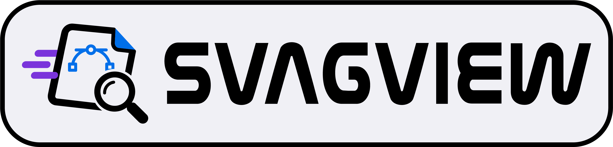

<div align="center">



# SvagView

### Ultra-Fast, Native Vector SVG & SVGZ Desktop Viewer

[](https://github.com/vaibhav-upadhyay/SvagView/actions/workflows/ci.yml)
[](https://github.com/vaibhav-upadhyay/SvagView/releases)
[](LICENSE)
[](https://www.rust-lang.org/)
[]()
[]()

*A lightweight, blazing-fast desktop SVG viewer built natively with **Rust**, **Slint**, **usvg**, **resvg**, and **tiny-skia**.*

[Features](#-key-features) • [Installation](#-installation) • [Shortcuts](#-keyboard-shortcuts) • [Architecture](#-architecture) • [Configuration](#-configuration) • [Contributing](#-contributing)

</div>

---

## ⚡ What Makes SvagView Special?

Most generic image viewers treat an SVG as a static bitmap: they rasterize it once at standard resolution, and as soon as you zoom in, the image dissolves into ugly, blurry pixels.

**SvagView is fundamentally different — it is a true native vector viewer:**

* 📐 **Zero-Pixel Infinite Vector Zooming**: SvagView evaluates SVG mathematical curves, Béziers, gradients, and text directly onto your monitor's physical pixel grid via affine transform matrices. Whether you zoom to 50%, 500%, or 50,000%, vector lines stay razor-sharp with sub-pixel anti-aliasing.
* 🎯 **1:1 Cursor-Locked Panning**: Mouse panning uses exact pointer-anchor offsets. Moving your mouse 10px moves the canvas by exactly 10px. Zero acceleration drift, zero jumping, zero rubber-banding.
* 🖼️ **True Vector Artboard**: Renders the SVG with its authentic document boundaries, aspect ratio, and artboard outline on a clean workspace, matching the UX of Figma, Adobe Illustrator, and Inkscape.
* 💾 **Constant Minimal Memory Footprint**: The raster buffer is bound only to the visible screen canvas (~3–5 MB), preventing memory spikes and out-of-memory crashes even under extreme zoom.
* 🚀 **Zero Chromium / Zero Electron**: Built entirely in 100% compiled native Rust with a Slint GUI. Starts in milliseconds, uses negligible RAM, and requires no web runtime.

---

## ✨ Key Features

### 🎨 Precision SVG Engine
- **Full SVG Compliance**: Powered by `resvg`, `usvg`, and `tiny-skia` for strict SVG 1.1 Full and SVG 2 standards compliance.
- **Complex Vector Constructs**:
  - Linear and radial gradients with custom spreads and transformations.
  - Arbitrary clipping paths (`clipPath`) and luminance/alpha masks (`mask`).
  - Cubic and quadratic Bézier curves, elliptical arcs, and even-odd fill rules.
  - SVG filters (`feGaussianBlur`, `feDropShadow`, `feColorMatrix`, `feBlend`, etc.).
  - System font integration via `fontdb` — renders SVG text elements using installed system fonts.
  - Seamless transparent decompression for gzip-compressed `.svgz` files.

### 🌓 Theme & Personalization
- **Clean Light Mode (Default)**: Crisp high-contrast appearance theme (`#ffffff`, `#f4f4f6`, `#eaeaea`) optimized for daylight viewing and documentation.
- **Dark Graphite Grey**: Elegant, neutral dark graphite theme (`#161619`, `#1f1f23`, `#26262c`) with clean zinc accents.
- **Instant Theme Toggle**: Toggle between Light Mode and Dark Graphite with a single click or press `T`.
- **4 Artboard Background Modes (`B`)**:
  - ⬜ **White (Default)**: Clean white canvas for web graphics and logos.
  - 🏁 **Checkerboard**: High-contrast transparency grid showing true alpha transparency inside the artboard.
  - ⬛ **Black**: Deep black backdrop for light vector icons.
  - 🎨 **Slate**: Neutral grey backdrop for balanced evaluation.
- **Persistent Preferences**: Remembers your theme, background style, and export presets across restarts (`%APPDATA%/SvagView/settings.json` on Windows).

### 🔍 Smooth Canvas & Interaction
- **Mouse-Wheel Zoom**: Zooms directly toward the cursor's focus point with smooth scaling.
- **Quick View Modes**:
  - `Fit to Window` (`0` or `F`)
  - `100% Actual Size` (`1`)
  - Incremental zoom controls (`+`, `-`, or toolbar buttons)
- **Interactive Drag & Drop**: Drop any `.svg` or `.svgz` file onto the window to open it immediately.
- **Lanczos3 Filtered Welcome Screen**: Displays a downscaled high-fidelity banner with smooth anti-aliased Lanczos filtering.

### 📁 File Management & Navigation
- **Folder Browsing**: Browse previous and next SVG files in the current folder using `‹` / `›`, `Left` / `Right` arrow keys, or `PageUp` / `PageDown`.
- **Native File Chooser**: Open files with `Ctrl+O` or the "Browse Files" button.
- **Live Disk Reload**: Press `F5` or `Ctrl+R` to immediately reload the current file from disk.
- **Command Line Support**: Pass a file path on launch: `svagview.exe "path/to/graphic.svg"`.

### 🛠️ External SVG Editor Integration
Automatically scans the operating system on launch and displays dedicated quick-launch buttons for installed vector graphics suites:
- 🖌️ **Inkscape**
- 🎨 **Adobe Illustrator**
- 📐 **CorelDRAW**
- ✨ **Affinity Designer**
- 💻 **VS Code** (for SVG XML source code inspection)
- 🌐 **System Default** (open with OS default association)

### 💾 Export & Clipboard
- **Customizable PNG Export (`Ctrl+E` / `Ctrl+S`)**:
  - Scale presets: **1x**, **2x (HiDPI / Retina)**, **4x (Ultra HD)**, **8x (Print Ready)**.
  - Background options: Transparent alpha, White, or Black.
  - High-precision rasterization with sub-pixel anti-aliasing.
- **Clipboard Integration**:
  - `Ctrl+C`: Copy rendered raster PNG bitmap directly to the OS clipboard (ready to paste into Slack, Discord, Photoshop, Figma, Word, etc.).
  - `Ctrl+Shift+C`: Copy SVG XML markup text to clipboard.
  - `Copy Path`: Quick button to copy file path.

### ℹ️ SVG Document Metrics & Status
- Live status bar displaying intrinsic dimensions (`width × height px`), `viewBox`, file size, render latency, and zoom percentage.
- **Document Info Dialog (`I`)**:
  - Full path, file size, dimensions, and viewBox coordinates.
  - Element breakdown: path count, group count, text nodes, gradients, clip paths, masks, and filters.
  - Real-time parse and render latency benchmarks.

---

## ⌨️ Keyboard Shortcuts

| Shortcut | Action |
|---|---|
| `Ctrl + O` | Open file chooser |
| `Left` / `PageUp` | Previous SVG in folder |
| `Right` / `PageDown` | Next SVG in folder |
| `Home` | First SVG in folder |
| `End` | Last SVG in folder |
| `F5` / `Ctrl + R` | Reload current SVG from disk |
| `+` / `=` / `Ctrl + =` | Zoom in |
| `-` / `Ctrl + -` | Zoom out |
| `0` / `Ctrl + 0` / `F` | Fit to window |
| `1` / `Ctrl + 1` | 100% Actual size |
| `Wheel` / `Ctrl + Wheel` | Zoom focused at mouse pointer |
| `Left Click + Drag` | 1:1 Smooth canvas pan |
| `B` | Cycle canvas background (White → Grid → Black → Slate) |
| `T` | Toggle Light Mode / Dark Graphite theme |
| `Ctrl + ,` | Open Settings & Preferences dialog |
| `I` | Toggle SVG Document Info dialog |
| `Ctrl + E` / `Ctrl + S` | Open PNG Export dialog |
| `Ctrl + C` | Copy rendered PNG bitmap to OS clipboard |
| `Ctrl + Shift + C` | Copy SVG XML source code to clipboard |
| `F11` | Toggle Fullscreen mode |
| `Escape` | Close active dialog / exit fullscreen |

---

## 📥 Installation

### Pre-built Binaries (Recommended)
Download the latest pre-compiled release for your platform from the [GitHub Releases](https://github.com/vaibhav-upadhyay/SvagView/releases) page:
* **Windows** (`x86_64`): `svagview-windows-x86_64.zip` (Portable executable with embedded icons)
* **Linux** (`x86_64`): `svagview-linux-x86_64.tar.gz`
* **macOS** (`x86_64` / `Apple Silicon`): `svagview-macos-*.tar.gz`

### Install with Cargo
If you have Rust installed, install SvagView directly via Cargo:
```bash
cargo install --git https://github.com/vaibhav-upadhyay/SvagView.git
```

### Build from Source

#### Prerequisites
- [Rust 1.85+](https://rustup.rs/)
- On Linux, install font and window dependencies:
  ```bash
  sudo apt-get install -y libfontconfig1-dev libxkbcommon-dev libxcb-shape0-dev libxcb-xfixes0-dev
  ```

#### Building
```bash
# Clone the repository
git clone https://github.com/vaibhav-upadhyay/SvagView.git
cd SvagView

# Run automated test suite
cargo test -- --nocapture

# Build optimized release binary
cargo build --release
```

The optimized binary will be located at:
* **Windows**: `target/release/svagview.exe`
* **Linux/macOS**: `target/release/svagview`

---

## 🏛️ Architecture

```
┌────────────────────────────────────────────────────────┐
│                      SvagView GUI                      │
│            (Slint Native UI + Event Handling)          │
└───────────────────────────┬────────────────────────────┘
                            │
               Viewport Transformations & Pan/Zoom
                            │
┌───────────────────────────▼────────────────────────────┐
│                    SvgEngine Pipeline                  │
│  ┌──────────────────┐  ┌─────────────────────────────┐ │
│  │   usvg Tree      │  │     tiny-skia Artboard      │ │
│  │ (SVG/SVGZ Parser)│  │   (Affinity Transformations)│ │
│  └─────────┬────────┘  └──────────────┬──────────────┘ │
│            │                          │                │
│            ▼                          ▼                │
│  ┌───────────────────────────────────────────────────┐ │
│  │            resvg High-Precision Raster            │ │
│  │     (Mathematical Curves → Screen Pixels)         │ │
│  └───────────────────────────────────────────────────┘ │
└───────────────────────────┬────────────────────────────┘
                            │
             Direct Shared Pixel Buffer Blit
                            │
┌───────────────────────────▼────────────────────────────┐
│                  Display / Window Surface              │
└────────────────────────────────────────────────────────┘
```

---

## ⚙️ Configuration

SvagView automatically saves your preferences upon every change and restores them when launched:
- **Default Theme**: Light Mode (`is_light_mode = true`)
- **Default Canvas Background**: White (`bg_mode = 1`)
- **Default PNG Export Scale**: 1x (`export_scale_preset = 1`)

### Configuration Paths
- **Windows**: `%APPDATA%\SvagView\settings.json`
- **Linux**: `$XDG_CONFIG_HOME/svagview/settings.json` or `~/.config/svagview/settings.json`
- **macOS**: `~/Library/Application Support/SvagView/settings.json`

Example `settings.json`:
```json
{
  "is_light_mode": true,
  "bg_mode": 1,
  "export_scale_preset": 1,
  "export_bg_mode": 0
}
```

---

## 🤝 Contributing

Contributions are welcome! Please check out [CONTRIBUTING.md](CONTRIBUTING.md) for development setup instructions, code style standards, and pull request guidelines.

---

## 📄 License

SvagView is dual-licensed under either:

* [MIT License](LICENSE)
* [Apache License, Version 2.0](LICENSE)

at your option.
